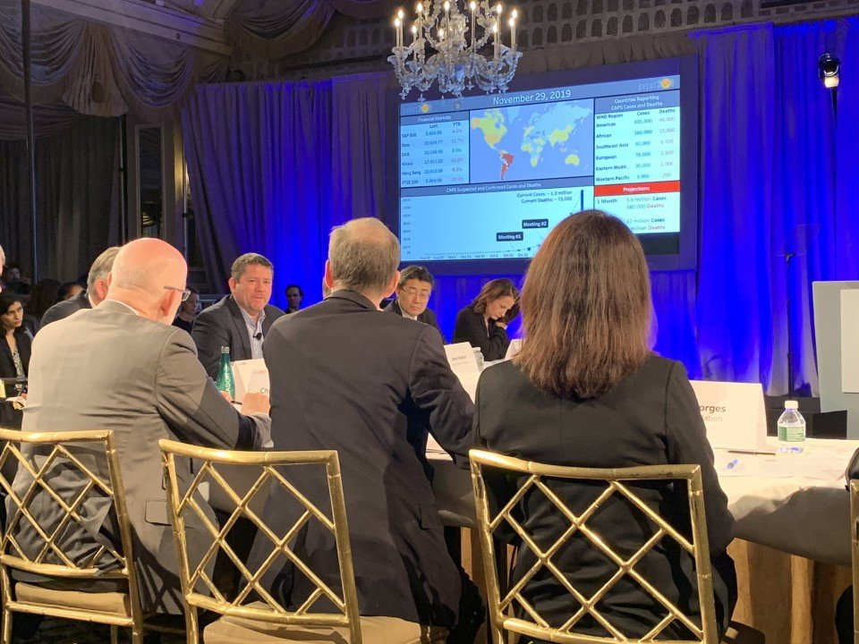
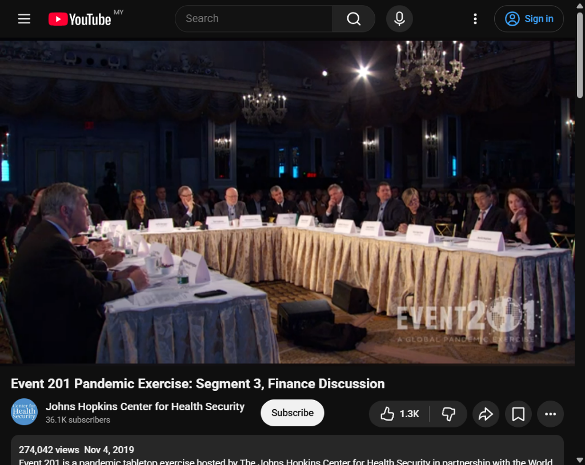

# CTF OSINT Writeup: 07 Conspiracy Theory

> **Category:** OSINT | **Platform:** Outback Overflow '26   

---

## Challenge 07: Conspiracy Theory

### 1. Challenge Overview
* **Category:** OSINT (Visual Geolocation, Event Triangulation & Tabletop Seating Reconstruction)
* **Points:** 75 Points
* **Challenge File:** `photo.jpg`
* **Target Seating Array:** Three foreground participants seated with backs to the camera (ordered Left ---> Middle ---> Right).
* **Flag Captured:** `OO{Christopher_Elias_Tom_Inglesby_Sofia_Borges}`

---

### 2. Clue Deconstruction & Technical Methodology
Visual event identification requires decomposing complex photographic scenes into distinct investigative vectors:
1. **Scenario Real-World Event Triangulation:** Slide presentations often display simulated scenario dates (e.g., hypothetical future milestones in crisis simulations) that do not match the physical date of the conference.
2. **U-Shaped Table Seating Geometry:** High-level international summits and tabletop crisis exercises frequently utilize a horseshoe / U-table arrangement with three distinct depth planes:
   * Near Wing (Foreground subjects, viewed from the rear)
   * Far Wing (Background subjects, seated opposite and facing the camera)
   * Head Table / Cross Table (Moderators and leadership)
3. **Optical Perspective Occlusion Trap:** In a narrow U-table configuration, nameplates standing on the **far** side of the table can visually align directly adjacent to a **foreground** subject's shoulder or torso, creating a false association if depth-of-field is not evaluated.
4. **Player Roster vs. Host Moderator Gap:** Official event press releases and attendee lists typically highlight only the invited panelist "players", omitting the session moderator who physically sits centrally along the table to direct discussions.

---

### 3. Step-by-Step Investigation Walkthrough

#### Step 1: Scene & Slide Artifact Deconstruction
Inspecting the background projection screen in the challenge photo:

The projection screen displayed the following text elements:
* **Event Branding:** `EVENT 201` (top left and right corners)
* **Scenario Milestone Date:** `November 29, 2019`
* **Epidemiological Modeling Slide:** `CAPS Suspected and Confirmed Cases and Deaths`
* **Statistics:** `Current Cases: ~1.3 million`, `Current Deaths: ~73,000`
* **Timeline Modules:** `Meeting #1`, `Meeting #2`

This identified the event as **Event 201**, a global pandemic tabletop exercise hosted by the **Johns Hopkins Center for Health Security** in partnership with the **World Economic Forum (WEF)** and the **Bill & Melinda Gates Foundation**.
* **Physical Event Date:** October 18, 2019
* **Location:** The Pierre hotel, New York City

#### Step 2: Resolving the Optical Perspective Occlusion Trap
A white nameplate reading `Jane Halton / ANZ Bank Group` appeared visually positioned next to the middle foreground attendee. However, evaluating the 3D room geometry revealed:
* The nameplate was standing upright facing toward the camera.
* It stood on the **far wing** of the U-table directly in front of former Australian Finance Minister **Jane Halton**.
* Due to telephoto lens perspective compression, the far-wing nameplate was positioned in line-of-sight behind the middle attendee's torso. Attributing this nameplate to the foreground seat was an optical trap.

#### Step 3: Multi-Angle Video Corroboration
To resolve the exact seating order along the foreground right wing, we audited the multi-angle broadcast recording published by the Johns Hopkins Center for Health Security:
* **Broadcast Recording:** *Event 201: Segment 3 - Finance Discussion* (`https://www.youtube.com/watch?v=rWRmlumcN_s`)

#### Step 4: Participant Identification (Left $\rightarrow$ Middle $\rightarrow$ Right)

1. **Left Attendee:**
   * **Visual Cues:** Bald male, grey suit, blue shirt.
   * **Nameplate Fragment:** Partial prefix `Ch...` visible on table.
   * **Identity:** **Dr. Christopher Elias**, President of Global Development at the Bill & Melinda Gates Foundation.
2. **Middle Attendee:**
   * **Visual Cues:** Dark hair, glasses, dark charcoal suit, seated directly at the central participant microphone.
   * **Roster Resolution:** Official summaries listed only 15 "players", excluding him. Video analysis revealed he was presiding over the exercise modules as the **Exercise Moderator**: **Dr. Tom Inglesby**, Director of the Johns Hopkins Center for Health Security.
3. **Right Attendee:**
   * **Visual Cues:** Female, dark curly hair, patterned beige/tan blouse.
   * **Nameplate Fragment:** Partial nameplate suffix `...orges` and organization snippet `...ation`.
   * **Identity:** **Sofia Borges**, Senior Vice President at the United Nations Foundation.

#### Step 5: Flag Assembly
Combining the three identities strictly in left-to-right camera perspective order:
* **Flag Captured:** `OO{Christopher_Elias_Tom_Inglesby_Sofia_Borges}`

* **Evidence Files:**
  * [`evidence/conspiracy_theory_photo.jpg`](evidence/conspiracy_theory_photo.jpg)
  * [`evidence/conspiracy_theory_seating_verification.png`](evidence/conspiracy_theory_seating_verification.png)

---

