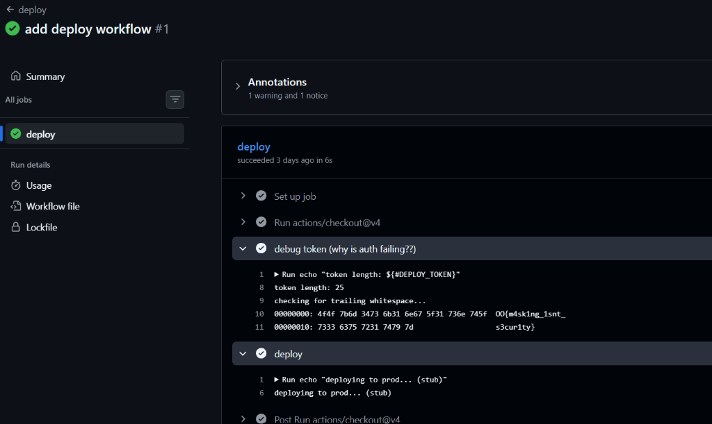

# CTF OSINT Writeup: 04 Git Blame III


> **Category:** OSINT | **Platform:** Outback Overflow '26   

---

## Challenge 04: Git Blame III

### 1. Challenge Overview
* **Category:** OSINT (CI/CD Pipeline Security & Workflow Log Masking Evasion)
* **Points:** 50 Points
* **Target Repository:** `https://github.com/outbackcorp-it/url-checker`
* **Target Workflow Run:** Run ID `44263715591` (Job ID `134662990502`)
* **Flag Captured:** `OO{m4sk1ng_1snt_s3cur1ty}`

---

### 2. Clue Deconstruction & Technical Methodology
Modern CI/CD runners (like GitHub Actions) feature automated secret masking engines: if a registered repository secret (e.g., `${{ secrets.DEPLOY_TOKEN }}`) is printed directly via `echo` or `stdout`, the runner's logging daemon intercepts the string and replaces it with `***`.

However, developers frequently attempt to "debug" failing authentication by transforming the secret into alternative representations (such as base64 encoding, character splitting, or hex dumping via `xxd`). Because the runner only performs exact string matching against the raw secret value, transformed representations completely bypass the regex/string redaction filter and are permanently recorded in the runner's execution logs.

---

### 3. Step-by-Step Investigation Walkthrough

#### Step 1: Locating the Workflow Run


In the `outbackcorp-it/url-checker` repository, we inspected the **Actions** tab (`/actions`). A workflow run titled `add deploy workflow #1` had executed:
* **Run URL:** `https://github.com/outbackcorp-it/url-checker/actions/runs/44263715591`
* **Job URL:** `https://github.com/outbackcorp-it/url-checker/actions/runs/44263715591/job/134662990502`

#### Step 2: Inspecting the Job Step Details
Expanding the job steps revealed a step labeled:
`debug token (why is auth failing??)`

Inside this step, the developer had executed:
```bash
echo "token length: ${#DEPLOY_TOKEN}"
# Output: token length: 25

checking for trailing whitespace...
# The developer executed: xxd -p or raw xxd dump to check for hidden newline characters:
```

#### Step 3: Evidence Screenshot & Hex Dump Extraction



The log output printed the raw hex dump of the secret:
```text
00000000: 4f4f 7b6d 3473 6b31 6e67 5f31 736e 745f  OO{m4sk1ng_1snt_
00000010: 7333 6375 7231 7479 7d                   s3cur1ty}
```

#### Step 4: Decoding the Hex Stream
Converting the hexadecimal values back to ASCII:
* `4f4f` ---> `OO`
* `7b6d 3473 6b31 6e67 5f31 736e 745f` ---> `{m4sk1ng_1snt_`
* `7333 6375 7231 7479 7d` ---> `s3cur1ty}`

Flag Captured:** `OO{m4sk1ng_1snt_s3cur1ty}

* **Evidence Files:**
  * [`evidence/git_blame_3_actions_log.png`](evidence/git_blame_3_actions_log.png)
  * [`evidence/git_blame_3_actions_log.txt`](evidence/git_blame_3_actions_log.txt)

---

