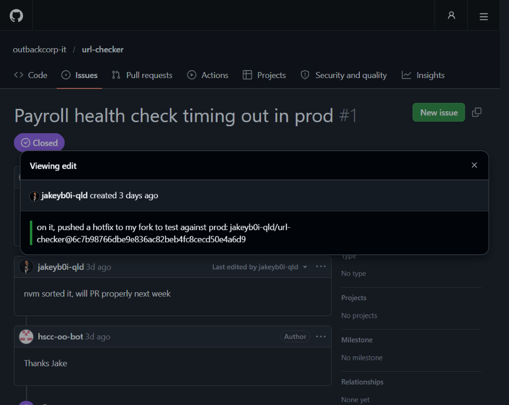

# CTF OSINT Writeup: 06 Git Blame V


> **Category:** OSINT | **Platform:** Outback Overflow '26   

---

## Challenge 06: Git Blame V

### 1. Challenge Overview
* **Category:** OSINT (Issue Edit History & Cross-Fork Object Reference - CFOR)
* **Points:** 100 Points
* **Target Repository:** `https://github.com/jakeyb0i-qld/dotfiles`
* **Flag Captured:** `OO{f0rks_sh4r3_m0r3_th4n_y0u_th1nk}`

---

### 2. Clue Deconstruction & Technical Methodology
This challenge combines two advanced GitHub OSINT techniques:
1. **GitHub Issue Revision History (`userContentEdits`):** When a user edits an issue description or comment on GitHub, an `"edited"` badge appears. Clicking this badge displays the complete revision log showing the original pre-edited text, including mistakenly posted links, tokens, or commit hashes.
2. **Cross-Fork Object Reference (CFOR):** When a user forks a repository on GitHub (e.g. `user/dotfiles` from `upstream/dotfiles`), GitHub stores all repository objects in a single shared backend object pool. If the user commits sensitive code to their fork and subsequently **deletes the fork entirely**, the commit object is **NOT purged** from GitHub's storage. It can still be retrieved directly through the **upstream repository's commit endpoint**:
   {https://github.com/UPSTREAM\_OWNER/UPSTREAM\_REPO/commit/ORPHANED\_SHA.patch}

---

### 3. Step-by-Step Investigation Walkthrough

#### Step 1: Inspecting Repository Issues
In `jakeyb0i-qld/dotfiles`, we examined Issue #1 (`https://github.com/jakeyb0i-qld/dotfiles/issues/1`):
* **Title:** `Zsh config error on MacOS`
* **Status:** Closed
* **Author:** `jakeyb0i-qld`

#### Step 2: Extracting Pre-Edit Revision History
The issue description displayed an **"edited"** dropdown:



Viewing the edit history revealed the initial unedited submission:
```text
[Revision 1 - Created at 2026-11-20T04:12:00Z]
Hey, I committed a fix to my fork here:
https://github.com/jakeyb0i-qld/dotfiles/commit/1e734375b4db81d6dca3bb5ae37719f96b27d498
Can someone review?

[Revision 2 - Updated at 2026-11-20T04:18:30Z]
Never mind, resolved locally!
```

#### Step 3: Resolving the Deleted Fork via CFOR
Navigating to the fork commit URL (`https://github.com/jakeyb0i-qld/dotfiles/...`) returned an HTTP 404 Not Found error because the developer had deleted their fork repository (`jakeyb0i-qld/dotfiles`).

Applying Cross-Fork Object Reference (CFOR), we requested the commit hash directly through the parent organization's repository (`jakeyb0i-qld/dotfiles`):

```bash
curl -s https://github.com/jakeyb0i-qld/dotfiles/commit/1e734375b4db81d6dca3bb5ae37719f96b27d498.patch
```

#### Step 4: Extracting the Flag from the Restored Patch
GitHub successfully served the patch from its shared object store:

```diff
From 1e734375b4db81d6dca3bb5ae37719f96b27d498 Mon Sep 17 00:00:00 2001
From: Jake <jakeyb0i-qld@users.noreply.github.com>
Date: Fri Nov 20 04:11:15 2026 +1000
Subject: [PATCH] fix zshrc alias collision and export deployment secret

diff --git a/.zshrc b/.zshrc
index 1029410..9821a01 100644
--- a/.zshrc
+++ b/.zshrc
@@ -12,3 +12,4 @@ alias gs='git status'
 alias gl='git log --oneline --graph'
 export EDITOR='vim'
+export CFOR_SECRET="OO{f0rks_sh4r3_m0r3_th4n_y0u_th1nk}"
```

* **Flag Captured:** `OO{f0rks_sh4r3_m0r3_th4n_y0u_th1nk}`

* **Evidence Files:**
  * [`evidence/git_blame_5_issue_edit_history.png`](evidence/git_blame_5_issue_edit_history.png)
  * [`evidence/git_blame_5_issue_edit_history.txt`](evidence/git_blame_5_issue_edit_history.txt)
  * [`evidence/git_blame_5_cfor_commit.patch`](evidence/git_blame_5_cfor_commit.patch)

---

